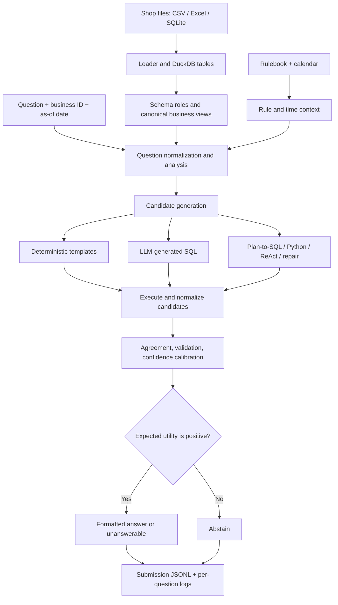

# DataMate Agent — System Design Overview

> **Purpose.** This document gives a concise, implementation-oriented overview of DataMate Agent. For the full module-by-module rationale and research context, see [the detailed design document](datamate-agent/docs/DESIGN.md). The evaluation record is maintained in [Results](datamate-agent/docs/RESULTS.md), and paper citations are listed in [References](datamate-agent/docs/REFERENCES.md).

## Contents

- [1. Scope and operating constraints](#1-scope-and-operating-constraints)
- [2. End-to-end architecture](#2-end-to-end-architecture)
- [3. Pipeline stages](#3-pipeline-stages)
- [4. Key design decisions](#4-key-design-decisions)
- [5. Answer-versus-abstain policy](#5-answer-versus-abstain-policy)
- [6. Runtime and reproducibility](#6-runtime-and-reproducibility)
- [7. Evidence and limitations](#7-evidence-and-limitations)
- [8. Further reading](#8-further-reading)

---

## 1. Scope and operating constraints

DataMate Agent answers Vietnamese business questions over shop data stored in CSV, Excel, and SQLite files. Its core design goal is to produce answers that can be executed and checked against the data—and to abstain when the system does not have enough evidence.

| Concern | Design response |
|---|---|
| Heterogeneous business files | Normalize source files into tables in an embedded DuckDB database. |
| Different shop schemas | Infer column roles from shop documentation, column names, and observed values. |
| Split-specific rules | Read the active rulebook at runtime; disable deterministic templates when their required rule clauses are absent. |
| Ambiguous or unsupported questions | Generate and execute candidates, inspect agreement and errors, and apply an answerability check. |
| Penalized Accuracy (PA) | Estimate answer correctness and apply a calibrated answer/abstain threshold. |
| Runtime and offline requirements | Bound execution, derive per-question seeds from the question context, write results incrementally, and check the declared model-parameter budget. |

The implementation is configured for the challenge constraints documented in the repository. The exact runtime and inference behavior must be evaluated in the target environment; the current recorded results are for the template-and-rules mode.

## 2. End-to-end architecture

## 3. Pipeline stages

| Stage | Main implementation | Responsibility |
|---|---|---|
| Ingestion | `datamate/loader.py` | Discover files, clean headers and values, merge compatible sheets/files, and register data in DuckDB. |
| Semantic interpretation | `datamate/readme.py`, `roles.py`, `salesview.py` | Infer table/column meaning and build canonical sales, order, product, and purchase views. |
| Question understanding | `textnorm.py`, `question.py`, `timeresolver.py`, `linker.py` | Normalize Vietnamese text, identify intent and filters, resolve periods, and link mentions to data values. |
| Candidate generation | `templates.py`, `agent.py`, `prompts.py` | Produce deterministic answers and, when enabled, SQL, plan-to-SQL, Python, and ReAct candidates. |
| Execution and selection | `executor.py`, `formatter.py`, `agent.py` | Execute candidates in bounded environments, normalize answer types, cluster equivalent outputs, and vote. |
| Reliability decision | `answerability.py`, `calibrate.py`, `scorer.py` | Track evidence and confidence, then answer, emit `unanswerable`, or abstain. |
| Operations | `scripts/run.py` | Enforce the declared parameter budget, write outputs incrementally, and retain per-question traces. |

## 4. Key design decisions

### 4.1 Normalize data before reasoning

The system does not ask an LLM to infer every detail from raw spreadsheets. It normalizes common data problems first: title rows, multi-row headers, repeated headers, total rows, mixed date and currency formats, unit-bearing quantities, and repeated monthly sheets. Column roles and shop documentation then support canonical views.

### 4.2 Apply business rules once

Shared sales semantics—such as valid orders, returns, revenue-line handling, base-unit quantities, and walk-in customers—are implemented in the canonical views rather than re-created independently by every candidate. View checks and lineage warnings become evidence for candidate selection.

### 4.3 Combine deterministic and model-generated candidates

Templates cover supported high-frequency question patterns. When an LLM is enabled, the agent can also generate direct SQL, plan-to-SQL, Python/pandas, and ReAct candidates, with execution feedback available for repair. Candidates are compared by their **executed answers**, not only by their generated text.

### 4.4 Treat the rulebook as runtime input

The active split's rulebook is passed to the LLM. Deterministic templates declare the clauses they implement; a template is disabled when the required clause is absent. This reduces the risk of applying a rule that changed between splits.

### 4.5 Make abstention an explicit action

An unsupported answer should not be replaced with a plausible-looking guess. The system looks for positive evidence that the data cannot answer the question and estimates candidate reliability before committing to an output.

## 5. Answer-versus-abstain policy

Under Penalized Accuracy, a correct answer scores (+1), a wrong answer scores (-1), and abstention scores (0). Let (p) be the estimated probability that a proposed answer is correct.

[
mathbb{E}[S \mid \text{answer}] = p(+1) + (1-p)(-1) = 2p - 1
]

Because abstention has expected score (0), the basic decision rule is to answer when (p > 0.5). The same logic applies to an `unanswerable` response: it is a scored answer and must be correct. The configured thresholds and calibration quality still matter; a probability estimate should not be treated as trustworthy merely because it is numeric.

## 6. Runtime and reproducibility

- The default configuration declares Qwen3-14B (14.8B parameters) and checks declared model sizes against the 15B total budget when LLM inference is enabled.
- The default run budget is 20,700 seconds, with a template-and-rules fallback after the configured fast-path cutoff.
- Per-question seeds are derived from question text, the as-of date, and candidate family—not from row IDs.
- Results are appended and flushed as decisions are made; the final output is restored to input order.
- Per-question logs record the answer, elapsed time, intent/time context, candidate programs, and execution outputs.

These are implementation/configuration properties, not a claim that the full GPU inference path has already been benchmarked end to end.

## 7. Evidence and limitations

The recorded template-only run reports **0.888 PA on 3,000 training questions** and produces non-abstaining outputs for 635 of 1,000 public questions. The training result is **in-sample**: failures were inspected on the training split and used to improve general-purpose parsing and data handling. The public split has no labels in this repository, so its output coverage is not a public-test accuracy or PA score.

The full LLM-enabled pipeline requires a separate run on the target GPU environment and a calibrator fitted to traces from that same inference mode. See [Results](datamate-agent/docs/RESULTS.md) for counts, interpretation, known fixes, and reproduction commands.

## 8. Further reading

- [Detailed architecture and design rationale](datamate-agent/docs/DESIGN.md)
- [Evaluation results and limitations](datamate-agent/docs/RESULTS.md)
- [Research references](datamate-agent/docs/REFERENCES.md)
- [Implementation setup and run instructions](datamate-agent/README.md)
