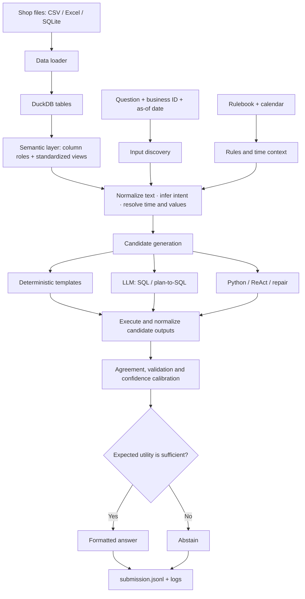

# DataMate Agent
### Zalo AI Challenge 2026

DataMate Agent answers Vietnamese business questions over shop data stored in **CSV, Excel, and SQLite**. It combines deterministic data processing with LLM-generated SQL/Python candidates, then checks candidate results and decides whether to answer or abstain.

> **Start here:** the implementation lives in [`datamate-agent/`](datamate-agent/). This top-level README is the project overview; the implementation-specific setup and commands are documented in [`datamate-agent/README.md`](datamate-agent/README.md).

---

## At a glance

- **Input:** a business question, shop data, a rulebook, and optional calendar data.
- **Data layer:** normalize heterogeneous files and build DuckDB tables and semantic views.
- **Reasoning:** parse the question, resolve dates and values, and generate candidate answers.
- **Verification:** execute candidates, compare their results, estimate confidence, and abstain when confidence is insufficient.
- **Output:** a structured `submission.jsonl` plus per-question logs.

## Architecture




## Repository map

```text
data-agent-ver1/
├── README.md                     # Project landing page (this file)
├── DESIGN.md                     # Detailed design note at repository root
├── datamate-agent/               # Main implementation
│   ├── README.md                 # Setup, run and competition instructions
│   ├── datamate/                 # Core pipeline modules
│   ├── configs/                  # Runtime and rule overrides
│   ├── scripts/                  # Run, evaluate, serve and fit calibration
│   ├── tests/                    # Unit and pipeline tests
│   ├── docs/
│   │   ├── DESIGN.md             # Detailed architecture and design rationale
│   │   ├── REFERENCES.md         # Papers and technical references
│   │   └── RESULTS.md            # Evaluation results and limitations
│   ├── submissions/              # Submission snapshots
│   ├── Dockerfile
│   ├── Makefile
│   └── requirements.txt
├── submission.jsonl              # Root-level submission snapshot
└── public_logs.zip                # Public-run logs archive
```

### Core modules

| Module | Responsibility |
|---|---|
| `loader.py` | Reads CSV/Excel/SQLite files, normalizes messy headers and values, and loads data into DuckDB. |
| `readme.py` + `roles.py` | Uses shop documentation and column evidence to infer column roles and table meaning. |
| `salesview.py` | Builds standardized business views and applies the rulebook's sales/order conventions. |
| `textnorm.py` + `question.py` | Normalizes Vietnamese queries and extracts intent, answer type, filters, thresholds, and top-k. |
| `timeresolver.py` + `lunar.py` | Resolves relative dates, periods, and lunar-calendar references. |
| `linker.py` + `answerability.py` | Links query terms to data values and detects cases where the requested information is unavailable. |
| `templates.py` | Generates deterministic candidates for supported question patterns. |
| `agent.py` + `prompts.py` | Orchestrates LLM candidate generation, planning, exploration, and repair. |
| `executor.py` + `formatter.py` | Executes candidates and converts outputs into the required answer schema. |
| `calibrate.py` + `scorer.py` | Estimates answer reliability and applies the answer/abstain decision rule. |

## Decision policy

The competition uses Penalized Accuracy (PA): a correct answer receives **+1**, a wrong answer **−1**, and abstaining **0**. If (p) is the estimated probability that an answer is correct, its expected score is:

[
\mathbb{E}[S] = p(1) + (1-p)(-1) = 2p - 1
]

Therefore, answering is preferable to abstaining when the calibrated probability is above **0.5**, subject to the project's configured decision thresholds. The confidence estimate is only as reliable as the data and calibration process behind it.

## Results and interpretation

The implementation README and results report distinguish the offline/template-only run from the full LLM pipeline. In-sample training results should **not** be treated as an estimate of unseen-shop performance, and public-test output without ground truth cannot establish public-test PA.

- [Implementation README and run instructions](datamate-agent/README.md)
- [Architecture and design rationale](datamate-agent/docs/DESIGN.md)
- [Research references](datamate-agent/docs/REFERENCES.md)
- [Results, evaluation setup and limitations](datamate-agent/docs/RESULTS.md)

## Quick start

Open a terminal at the repository root, then enter the implementation directory:

```bash
cd datamate-agent
python -m pip install -r requirements.txt
python -m pytest -q tests
```

For GPU inference, offline/template-only execution, data layout, evaluation, calibration, and Docker submission instructions, follow [`datamate-agent/README.md`](datamate-agent/README.md). Do not place private competition data, API keys, or downloaded model weights in Git.

## Reproducibility and responsible reporting

- Keep data splits, rulebooks, and evaluation configuration explicit.
- Report the exact mode used: template-only, simulated LLM, or real LLM inference.
- Record the model, configuration, random seed, runtime, and output logs for each experiment.
- Evaluate by shop/group where appropriate; avoid relying only on in-sample metrics.
- Do not claim a public-test score unless the corresponding ground truth and official scoring procedure are available.

---

**For contributors:** start with the implementation README, then read `configs/default.yaml`, `datamate/agent.py`, and the relevant module before changing pipeline behavior. Run the tests before proposing a merge.
