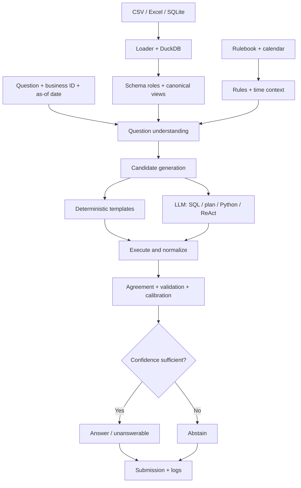

# DataMate Agent

**Zalo AI Challenge 2026** · Vietnamese business-question answering over CSV, Excel, and SQLite data


## Documentation guide

This is the **only repository README** and the main entry point. Follow the guides below in order depending on what you need.

| If you want to… | Read |
|---|---|
| Install dependencies, run tests, generate a submission, or configure GPU/Docker inference | [Getting Started](datamate-agent/GETTING_STARTED.md) |
| Understand the architecture at a glance | [System Design Overview](DESIGN.md) |
| Understand each component, its rationale, and research connections | [Detailed Design](datamate-agent/docs/DESIGN.md) |
| Prepare the input split and understand the expected data layout | [Data Layout](datamate-agent/docs/DATA_LAYOUT.md) |
| Understand the measured results, known failure modes, and limitations | [Evaluation Results](datamate-agent/docs/RESULTS.md) |
| Find the papers and methods cited by the design | [Research References](datamate-agent/docs/REFERENCES.md) |

### Suggested reading paths

**New contributor:** start with [Getting Started](datamate-agent/GETTING_STARTED.md), then read the [System Design Overview](DESIGN.md) and the [Detailed Design](datamate-agent/docs/DESIGN.md). Consult [Data Layout](datamate-agent/docs/DATA_LAYOUT.md) before adding or testing a new shop schema.

**Reproducing results:** follow [Getting Started](datamate-agent/GETTING_STARTED.md) for commands, then [Evaluation Results](datamate-agent/docs/RESULTS.md) for the exact interpretation and reproduction steps.

**Researching a method:** find its reference label in [Detailed Design](datamate-agent/docs/DESIGN.md), then look it up in [Research References](datamate-agent/docs/REFERENCES.md).

## Pipeline overview

1. **Load and normalize data** from CSV, Excel, and SQLite into DuckDB.
2. **Build a semantic layer** using shop documentation, inferred column roles, canonical business views, and the active rulebook.
3. **Understand the question** by normalizing Vietnamese text, identifying intent and filters, and resolving dates and entity mentions.
4. **Generate candidates** using deterministic templates and, when enabled, SQL, plan-to-SQL, Python/pandas, and ReAct.
5. **Execute and validate** candidates, compare normalized answers, estimate confidence, and answer or abstain.
6. **Write outputs** to the submission JSONL and per-question logs.



## Current recorded results

These figures are from **template-and-rules mode without an LLM**. They do not represent a full Qwen3-14B GPU run.

| Split | Correct | Wrong | Abstain | PA |
|---|---:|---:|---:|---:|
| Train: 3,000 questions, in-sample | 2,667 | 3 | 330 | 0.888 |
| Public: 1,000 questions, no labels available | — | — | 365 | Not available |

The public run produced 611 typed answers and 24 `unanswerable` outputs, for 635 non-abstaining outputs in total. Public ground truth is not included, so this is **coverage, not public-test accuracy or PA**. The training result is in-sample because training failures were inspected during development.

See [Evaluation Results](datamate-agent/docs/RESULTS.md) for the full record and caveats.

## Repository map

The tree below lists the **tracked files currently present in the repository**, including the Python source files, command-line scripts, tests, configuration, and documentation. Inline comments describe each module's primary responsibility.

```text
data-agent-ver1/
├── README.md
├── DESIGN.md
├── submission.jsonl                  # Root-level public-test submission snapshot
├── public_logs.zip                   # Archived public-run logs
└── datamate-agent/
    ├── .gitignore
    ├── Dockerfile                    # Container image for the application
    ├── GETTING_STARTED.md            # Setup, run modes, evaluation, calibration, Docker
    ├── LICENSE
    ├── Makefile                      # Test and development commands
    ├── predict.sh                    # Challenge inference entry point
    ├── pyproject.toml                # Python package/tool configuration
    ├── requirements.txt              # Python dependencies
    ├── artifacts/
    │   ├── .gitkeep
    │   └── calibrator_offline.pkl    # Offline/prior calibrator artifact
    ├── configs/
    │   ├── default.yaml              # Runtime, model, candidate, and decision settings
    │   └── rulebook_overrides.yaml   # Structured overrides for rulebook conventions
    ├── datamate/
    │   ├── __init__.py
    │   ├── agent.py                  # Candidate generation, escalation, selection, voting
    │   ├── answerability.py          # Evidence-based answerability checks
    │   ├── attributes.py             # Business/catalog attribute extraction
    │   ├── calibrate.py              # Confidence calibration and probability estimation
    │   ├── config.py                 # Configuration loading and overrides
    │   ├── executor.py               # Bounded SQL/Python execution and result handling
    │   ├── formatter.py              # Typed answer normalization and output formatting
    │   ├── linker.py                 # Question-to-data-value/entity linking
    │   ├── llm.py                    # LLM backend/client interface
    │   ├── loader.py                 # CSV/Excel/SQLite ingestion and DuckDB preparation
    │   ├── lunar.py                  # Vietnamese lunar-calendar calculations/fallback
    │   ├── prompts.py                # LLM system/task prompts
    │   ├── question.py               # Intent, filters, answer type, and time-question parsing
    │   ├── readme.py                 # Shop README/column-dictionary parsing
    │   ├── roles.py                  # Table and column role inference
    │   ├── rulebook.py               # Rulebook parsing, settings, and clause fingerprints
    │   ├── salesview.py              # Canonical sales/order/product/purchase views
    │   ├── scorer.py                 # Candidate evidence and scoring features
    │   ├── synthetic.py               # Synthetic data/question helpers
    │   ├── templates.py               # Deterministic business-question answer templates
    │   ├── textnorm.py               # Vietnamese text normalization
    │   └── timeresolver.py           # Date-range and time-expression resolution
    ├── docs/
    │   ├── DATA_LAYOUT.md             # Expected input split and data-folder structure
    │   ├── DESIGN.md                 # Detailed component design and research rationale
    │   ├── REFERENCES.md              # Research bibliography and reference labels
    │   └── RESULTS.md                 # Recorded results, reproduction notes, limitations
    ├── scripts/
    │   ├── eval_templates.py          # Evaluate deterministic template mode
    │   ├── evaluate.py                # Evaluate saved predictions against labels
    │   ├── fit_calibrator.py          # Fit and inspect the confidence calibrator
    │   ├── inspect_business.py        # Inspect one business/schema
    │   ├── make_synthetic.py          # Generate synthetic development fixtures
    │   ├── run.py                     # Main inference/orchestration entry point
    │   └── serve_vllm.sh              # Start the vLLM model server
    ├── submissions/
    │   └── public_test_round1.jsonl   # Public-test submission snapshot
    └── tests/
        ├── conftest.py                # Shared pytest fixtures
        ├── test_pipeline.py           # End-to-end/pipeline tests
        └── test_units.py               # Unit tests
```

**Data note:** The tracked tree does not include the challenge input-data directories. Prepare or mount those files locally using [Data Layout](datamate-agent/docs/DATA_LAYOUT.md); their absence from this listing does not mean the loader lacks CSV, Excel, or SQLite support.

## Quick check

From the repository root:

```bash
cd datamate-agent
python -m pip install -r requirements.txt
make test
```

For all run modes and submission instructions, continue to [Getting Started](datamate-agent/GETTING_STARTED.md).

## Reporting principles

Keep template-only, simulated-LLM, and real-LLM results separate. Record the model, configuration, split, seed policy, runtime, submission, and per-question logs. Do not claim a public-test score without the corresponding ground truth and official scoring procedure.
