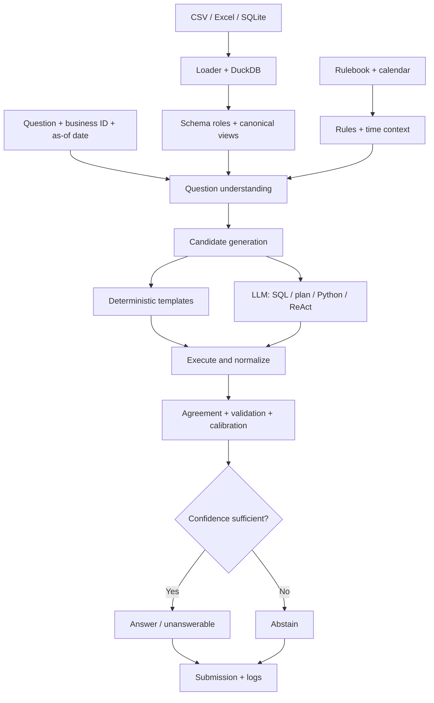

# DataMate Agent

**Zalo AI Challenge 2026** · Vietnamese business-question answering over CSV, Excel, and SQLite data

DataMate Agent combines deterministic data processing with optional LLM-generated SQL/Python candidates. It executes and compares candidate results, estimates answer reliability, and decides whether to answer or abstain.

## Documentation guide

This is the **only repository README** and the main entry point. Follow the guides below in order depending on what you need.

| If you want to… | Read |
|---|---|
| Install dependencies, run tests, generate a submission, or configure GPU/Docker inference | [Getting Started](datamate-agent/GETTING_STARTED.md) |
| Understand the architecture at a glance | [System Design Overview](DESIGN.md) |
| Understand each component, its rationale, and research connections | [Detailed Design](datamate-agent/docs/DESIGN.md) |
| Prepare the input split and understand the expected data layout | [Data Layout](datamate-agent/docs/DATA_LAYOUT.md) |
| Understand the measured results, known failure modes, and limitations | [Evaluation Results](datamate-agent/docs/RESULTS.md) |
| Find the papers and methods cited by the design | [Research References](datamate-agent/docs/REFERENCES.md) |

### Suggested reading paths

**New contributor:** start with [Getting Started](datamate-agent/GETTING_STARTED.md), then read the [System Design Overview](DESIGN.md) and the [Detailed Design](datamate-agent/docs/DESIGN.md). Consult [Data Layout](datamate-agent/docs/DATA_LAYOUT.md) before adding or testing a new shop schema.

**Reproducing results:** follow [Getting Started](datamate-agent/GETTING_STARTED.md) for commands, then [Evaluation Results](datamate-agent/docs/RESULTS.md) for the exact interpretation and reproduction steps.

**Researching a method:** find its reference label in [Detailed Design](datamate-agent/docs/DESIGN.md), then look it up in [Research References](datamate-agent/docs/REFERENCES.md).

## Pipeline overview

1. **Load and normalize data** from CSV, Excel, and SQLite into DuckDB.
2. **Build a semantic layer** using shop documentation, inferred column roles, canonical business views, and the active rulebook.
3. **Understand the question** by normalizing Vietnamese text, identifying intent and filters, and resolving dates and entity mentions.
4. **Generate candidates** using deterministic templates and, when enabled, SQL, plan-to-SQL, Python/pandas, and ReAct.
5. **Execute and validate** candidates, compare normalized answers, estimate confidence, and answer or abstain.
6. **Write outputs** to the submission JSONL and per-question logs.



## Current recorded results

These figures are from **template-and-rules mode without an LLM**. They do not represent a full Qwen3-14B GPU run.

| Split | Correct | Wrong | Abstain | PA |
|---|---:|---:|---:|---:|
| Train: 3,000 questions, in-sample | 2,667 | 3 | 330 | 0.888 |
| Public: 1,000 questions, no labels available | — | — | 365 | Not available |

The public run produced 611 typed answers and 24 `unanswerable` outputs, for 635 non-abstaining outputs in total. Public ground truth is not included, so this is **coverage, not public-test accuracy or PA**. The training result is in-sample because training failures were inspected during development.

See [Evaluation Results](datamate-agent/docs/RESULTS.md) for the full record and caveats.

## Repository map

```text
data-agent-ver1/
├── README.md                         # Single project entry point
├── DESIGN.md                         # High-level architecture
├── datamate-agent/
│   ├── GETTING_STARTED.md            # Setup, inference, evaluation, Docker
│   ├── datamate/                     # Agent and data-processing modules
│   ├── configs/                      # Runtime configuration and rule overrides
│   ├── scripts/                      # Run, evaluate, serve, calibrate
│   ├── tests/                        # Unit and pipeline tests
│   └── docs/
│       ├── DESIGN.md                 # Detailed architecture and rationale
│       ├── DATA_LAYOUT.md            # Expected data split structure
│       ├── REFERENCES.md             # Research bibliography
│       └── RESULTS.md                # Evaluation and limitations
├── submission.jsonl                  # Root-level submission snapshot
└── public_logs.zip                   # Public-run log archive
```

## Quick check

From the repository root:

```bash
cd datamate-agent
python -m pip install -r requirements.txt
make test
```

For all run modes and submission instructions, continue to [Getting Started](datamate-agent/GETTING_STARTED.md).

## Reporting principles

Keep template-only, simulated-LLM, and real-LLM results separate. Record the model, configuration, split, seed policy, runtime, submission, and per-question logs. Do not claim a public-test score without the corresponding ground truth and official scoring procedure.
