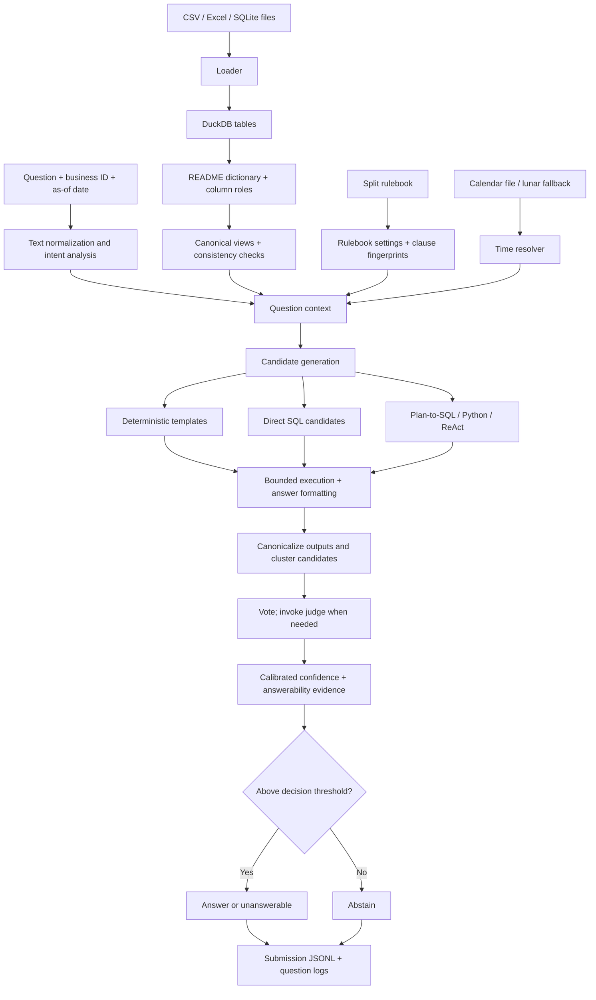

# DataMate Agent — Detailed Design

> **Document scope:** implementation-level architecture, design rationale, safeguards, and research context for the DataMate submission in Zalo AI Challenge 2026. This document describes the code and configuration in this repository; it does not imply that every mode has been benchmarked on the target GPU setup.
>
> **Related documents:** [Results](RESULTS.md) · [References](REFERENCES.md) · [Implementation and run guide](../README.md) · [Repository-level design overview](../../DESIGN.md)

## Contents

1. [Problem setting and design evidence](#1-problem-setting-and-design-evidence)
2. [Decision policy under Penalized Accuracy](#2-decision-policy-under-penalized-accuracy)
3. [End-to-end architecture](#3-end-to-end-architecture)
4. [Pipeline design](#4-pipeline-design)
   - [4.1 Data ingestion and DuckDB](#41-data-ingestion-and-duckdb)
   - [4.2 Shop documentation and schema roles](#42-shop-documentation-and-schema-roles)
   - [4.3 Canonical business views](#43-canonical-business-views)
   - [4.4 Rulebook-aware behavior](#44-rulebook-aware-behavior)
   - [4.5 Time and lunar-calendar resolution](#45-time-and-lunar-calendar-resolution)
   - [4.6 Question understanding and value linking](#46-question-understanding-and-value-linking)
   - [4.7 Deterministic templates](#47-deterministic-templates)
   - [4.8 LLM candidate generation and selection](#48-llm-candidate-generation-and-selection)
   - [4.9 Answerability evidence](#49-answerability-evidence)
   - [4.10 Confidence calibration](#410-confidence-calibration)
   - [4.11 Runtime, constraints, and output artifacts](#411-runtime-constraints-and-output-artifacts)
5. [Generalization to unseen business types](#5-generalization-to-unseen-business-types)
6. [Planned ablation study](#6-planned-ablation-study)
7. [Limitations and validation status](#7-limitations-and-validation-status)
8. [References](#8-references)

---

## 1. Problem setting and design evidence

DataMate answers Vietnamese business questions about small-shop data supplied as CSV, Excel, or SQLite files. Each question is associated with a business, an `as_of_date`, and the rulebook for its split. A shop may provide a README containing a column dictionary or business conventions.

The design is driven by the observed data format and challenge constraints.

| Observed challenge characteristic | Consequence for the implementation |
|---|---|
| The recorded train split contains 3,000 questions across 30 shops; the public split contains 1,000 questions across 14 shops. | A result on train is not by itself evidence of generalization to unseen shops. |
| Answer types include numbers (about 63%), percentages (about 19%), lists (about 6%), dates (about 5%), strings, booleans, tables, and `unanswerable`. | Output typing and formatting are part of correctness; a semantically plausible answer in the wrong schema can still fail scoring. |
| Roughly 73% of questions belong to the sales-analysis core: revenue, order counts and cancellations, average order value, period-over-period change, best-selling periods, top-k entities, group shares, and base-unit quantities. | Cover common patterns with deterministic templates over standardized views; leave unsupported patterns to the LLM path or abstention. |
| Questions are paraphrased and contain informal Vietnamese, abbreviations, unaccented text, Telex typing errors, and typos. | Normalize text conservatively and share that normalization across intent parsing and value linking. |
| Business data appears in many layouts: monthly sheets/files, multi-row headers, title rows, repeated headers, total rows, mixed date/currency formats, quantities with units, SQLite names in camelCase, and English column labels. | The loader and schema inference must tolerate variation before candidate generation begins. |
| Shop READMEs often contain useful column descriptions, but their quality varies. | Treat the README as strong evidence, not as infallible metadata; fall back to header names and observed values. |
| The rulebook can differ across splits, including industry-specific conventions. | Treat the active rulebook as runtime input and guard each deterministic template with fingerprints of the rules it implements. |
| Some questions are unanswerable because the period is outside the data or the shop does not record the requested attribute. | Require positive evidence before asserting that a question is unanswerable. |

The design uses research as guidance rather than as a claim of equivalent benchmark performance. Reference identifiers such as `[R7]` map to the bibliography in [References](REFERENCES.md).

## 2. Decision policy under Penalized Accuracy

Penalized Accuracy (PA) assigns **+1** to a correct answer, **−1** to an incorrect answer, and **0** to abstention. Let (p=P(\text{correct}\mid x)) be the estimated probability that a candidate answer is correct.

[
\begin{aligned}
\mathbb{E}[S\mid\text{answer}] &= p(+1)+(1-p)(-1)=2p-1,\\
\mathbb{E}[S\mid\text{abstain}] &= 0.
\end{aligned}
]

Therefore, the basic PA-optimal reject rule is:

[
\boxed{\text{Answer if }p>0.5;\quad\text{otherwise abstain.}}
]

This is the reject-option decision described by Chow [R27] and is closely related to selective classification [R28]. An `unanswerable` response is still an answer and is subject to the same rule. It should only be selected when the evidence supports it.

The practical challenge is to estimate (p) reliably. Candidate agreement, cross-family agreement, execution failures, empty results, rule-based answerability evidence, unresolved links, and semantic-view self-checks feed the confidence model. Calibration quality depends on using representative labeled examples and avoiding leakage across shops.

## 3. End-to-end architecture

## 4. Pipeline design

### 4.1 Data ingestion and DuckDB

**Implementation:** `datamate/loader.py`  
**Technology:** DuckDB [R34]

The loader discovers shop files and converts them into in-process DuckDB tables. The preprocessing layer handles:

- Report title rows above the actual header and multi-row headers where an upper row contains group labels such as “Order” or “Products”.
- Repeated header rows, fully empty rows, footnotes, and total rows such as “Cộng ngày …” or “Tổng cộng”.
- Monthly data split across several sheets or files. Compatible tables are concatenated and retain a sheet indicator.
- Mixed Vietnamese data formats, including `45k`, `45.000đ`, `6,719.0000`, quantities such as `15 vỉ`, Excel date serials, `1 thg 6 2025`, and day/month values whose year is inferred from the sheet or file name.
- Spreadsheet, CSV, and SQLite sources; parsed tables are cached using file size, modification time, and a loader-version marker.

The loader distinguishes a real customer name from a total-row label by checking the first textual cell of the row. This avoids removing a genuine customer whose name begins with “Tống” merely because the same row contains numeric values.

This design follows a practical lesson from enterprise Text-to-SQL research: generation quality is limited when the schema and data are misread at the start. Cleaning is performed before asking an LLM to reason over the data.

### 4.2 Shop documentation and schema roles

**Implementation:** `datamate/readme.py`, `datamate/roles.py`

Schema linking is central to systems such as RESDSQL [R6], CHESS [R7], and CHASE-SQL [R8]. Each shop's schema is usually small enough that the implementation attempts to assign roles to every column rather than aggressively pruning the schema.

Evidence is considered in this order:

1. Column descriptions and conventions found in the shop README.
2. Normalized column names, including Vietnamese, English, abbreviations, and camelCase.
3. Observed value types and value patterns.

README descriptions are matched carefully so that a conversion-factor note is not mistaken for a unit label. Currency suffixes are normalized before matching headers such as `Thành tiền (đ)` or `Giảm (VNĐ)`.

Tables are classified using sheet/table names before file names. Recognized business categories include sales, purchases, stock, lots, payments, deliveries, debt, expenses, returns, warranties, customers, suppliers, products, unit conversions, and staff. Generic fields such as `name` are interpreted in the context of the table: a name in a staff table is a staff member, while a name in a product catalog is a product.

### 4.3 Canonical business views

**Implementation:** `datamate/salesview.py`

The semantic layer constructs canonical views where enough information is available:

- `v_sales`: one row per sold line, with normalized dates, status, quantities, amounts, product/customer/staff identifiers, payment, and channel.
- `v_orders`: one row per order with order-level fields and revenue.
- `v_products`: product-catalog information.
- `v_purchases`: purchase/receipt information when the source data supports it.

Business rules are applied once at this layer instead of being reimplemented independently by every candidate:

- A valid order is not cancelled and not returned. A return in any line can invalidate the whole order, including partial returns, negative lines, positive returned quantity, or return notes.
- Revenue is the sum of line amounts after line discounts. Order-level vouchers, points, and shipping fees are excluded; a service fee can contribute to revenue without being treated as a product.
- Quantities are converted to the base unit using conversion tables, textual conversion factors, or README conventions. Chained conversions such as “1 box = 15 strips” and “1 strip = 12 tablets” are multiplied to obtain the base quantity.
- Blank follow-up cells inherit the order-level value from the first row. Identical duplicate export rows for the same order are counted once.
- Walk-in customers are not treated as named customers. Equivalent customer names that differ only in phone-number formatting are normalized; when orders refer to a staff/customer code, a name-to-code alias table supports filtering by the name in the question.
- Where the source format implies one row per receipt, each row can represent a transaction even when no conventional order ID exists.

**Consistency checks.** The view builder checks relationships such as `quantity × unit price ≥ line amount` and compares the sum of line amounts with the recorded goods total where both values are available. Check results, lineage, and warnings become confidence features and are exposed to the LLM. Raw tables remain available for cases where a canonical view is insufficient.

### 4.4 Rulebook-aware behavior

**Implementation:** `datamate/rulebook.py`, `configs/rulebook_overrides.yaml`

The challenge may provide different rulebooks for different splits. The rulebook is therefore treated as authoritative runtime input, not as a single fixed training constant.

The implementation uses it in three ways:

1. **Prompt text:** include the active rulebook in the system prompt so the LLM can read the actual rules for the current split.
2. **Structured settings:** infer conventions needed by deterministic code from explicit text; use `rulebook_overrides.yaml` only for settings not found in the text.
3. **Clause fingerprints:** each deterministic template declares the rule clauses it implements. If the active rulebook does not contain a required clause, that template is disabled.

For example, if a split removes the rule for average purchase price, the corresponding template must not silently keep applying it. The LLM can instead reason from the rulebook text and underlying tables. This mechanism is a safety valve against rulebook drift.

### 4.5 Time and lunar-calendar resolution

**Implementation:** `datamate/timeresolver.py`, `datamate/lunar.py`

The LLM is not expected to calculate dates from prose. The resolver converts time expressions into explicit half-open intervals `[start, end)` and passes the resolved context to candidate generation.

Supported patterns include yesterday, the last (N) days (including today where required), this/last week, month-to-date, a month without a year, quarters, inclusive start/end periods, a selected set of months, an (N)-day interval compared with the immediately preceding interval, the same period last year, Tet-related windows, morning/afternoon shifts, and snapshots through a specified date.

The active challenge calendar file takes precedence for solar–lunar dates. The fallback uses the Vietnamese lunar-calendar algorithm associated with Hồ Ngọc Đức [R37], informed by astronomical calculations such as Meeus [R38]. The project notes tests for Tet dates from 2023–2027 and the 2025 leap month.

### 4.6 Question understanding and value linking

**Implementation:** `datamate/textnorm.py`, `question.py`, `linker.py`, `attributes.py`

Question analysis uses deterministic rules before candidate generation. It extracts the likely intent, expected answer type, top-(k), thresholds such as “at least (X)” or “above (X)”, time periods, and filters such as product group, customer group, payment method, sales channel, shift, or size. The intent vocabulary has roughly 30 categories.

Value linking maps question mentions to values found in the shop data. Instead of relying on an approximate schema-wide retrieval step, the linker compares question spans with distinct data values using normalized matching and `rapidfuzz`, checks aliases, and flags ambiguous matches [R25].

Normalization is intentionally conservative:

- Telex correction is accepted only when the result is a valid Vietnamese syllable, to avoid corrupting names such as “Acyclovir” or English words such as “order”.
- Ambiguous abbreviations are expanded only when the query is unaccented, avoiding a mistaken rewrite of an accented word.
- Diacritics are evidence during value matching. A phrase about payment by bank transfer must not accidentally match a product whose name begins with “Trà”.
- Catalog attributes—such as active ingredient, brand, and prescription status—can become filters when the catalog and README provide supporting evidence.

If a named entity or a catalog attribute in the question cannot be resolved into a filter, a deterministic template withdraws rather than quietly answering a broader question.

### 4.7 Deterministic templates

**Implementation:** `datamate/templates.py`

Each template is a small, auditable program covering a supported intent, such as revenue, order count, cancellation rate, average order value, period change, best-selling period, top-k product/customer, group share, quantity, or selected purchase metrics.

A template runs only when its required slots—period, filters, entity links, and needed rulebook clauses—are resolved. It returns a typed result, a strength score in `[0, 1]`, and a short evidence record.

Unexplained tokens reduce template strength. Unsupported entity or catalog constraints cause the template to withdraw rather than return a misleading whole-shop aggregate. Templates are treated as one independent candidate family; agreement with an independently generated LLM candidate is therefore a useful cross-family signal.

### 4.8 LLM candidate generation and selection

**Implementation:** `datamate/agent.py`, `prompts.py`, `executor.py`

When an LLM backend is enabled, candidate generation is adaptive:

| Candidate family | Role and research connection |
|---|---|
| Direct SQL samples (batched) | Self-consistency [R11] and candidate voting, including the general multi-generator idea in Arctic-Text2SQL-R1 [R10]. |
| Plan-to-SQL | Breaks a problem into a plan and executable query, inspired by divide-and-conquer approaches such as CHASE-SQL [R8]. |
| Python/pandas | Provides an independent data-analysis path, related to CodeAct [R13] and InfiAgent-DABench [R15]. |
| ReAct exploration | Lets the agent inspect data and refine its approach through tool results [R12]. |
| Execution-feedback repair | Uses execution errors as feedback, related to execution-guided decoding [R16] and Self-Debugging [R17]. |
| Executed-answer clustering and voting | Groups semantically equivalent candidates by their normalized, executed output; agreement is a reliability signal [R23, R24]. |
| One-off judge call | Breaks ties when the top two answer clusters are close, avoiding the large number of pairwise comparisons used by heavier selectors. |

The agent stops early when the configured number of candidates agree and, if a template fired, the template agrees too. Otherwise it escalates to plan-to-SQL, Python, an optional second SQL model, and ReAct exploration. Each generated program runs under a timeout and result-size limits.

Monte Carlo Tree Search (MCTS), as used by Alpha-SQL [R4], is not part of this implementation because its search overhead conflicts with the challenge's inference-time budget. During repair, a model-generated `unanswerable` is treated as repair failure rather than as an independent vote; small-model smoke tests showed that this could otherwise become an easy way to avoid debugging.

### 4.9 Answerability evidence

**Implementation:** `datamate/answerability.py`

An `unanswerable` conclusion requires positive evidence, consistent with the challenge rulebook and the motivation of PRACTIQ [R22]. Examples include:

- The requested period lies completely outside the available data range.
- The shop does not record a required attribute, such as gender, address, return reason, channel, stock, purchase details, cost, debt, expiry, time, or staff.
- A named product is absent from the shop data.
- The question asks for a subjective judgment that cannot be derived from recorded sales data.

A period that overlaps the available data is not automatically considered unanswerable: supported portions may still be answerable under the active rules. Answerability evidence is passed to confidence estimation; it does not bypass the final decision policy.

### 4.10 Confidence calibration

**Implementation:** `datamate/calibrate.py`, `scripts/fit_calibrator.py`

The calibrator maps execution and semantic features to an estimated probability of correctness. Features include:

- Agreement among candidates and the margin between the leading answer clusters.
- Agreement across candidate families and answer-type agreement.
- Whether a template fired, template strength, and template/LLM agreement.
- Execution-error and empty-result rates.
- Positive unanswerability evidence.
- Value-linking score and ambiguity.
- Time-range validity, candidate count, whether an LLM was used, whether escalation occurred, intent, and semantic-view consistency checks.

Before labeled calibration data is available, the system uses a configured prior. With labeled examples, it fits logistic regression and applies isotonic correction when at least 300 labeled candidate examples are available. The calibration script estimates transfer using grouped folds by business, so questions from the same shop do not appear in both the fitting and held-out fold. It then fits a final calibrator on all labeled candidate examples for the artifact used at inference.

The script can also explore a threshold by bootstrap. Because selecting a threshold on the same out-of-fold predictions can still be optimistic, keep the theoretical (0.5) cutoff unless a different threshold is stable across validation folds. Conformal abstention [R26] is treated as a safety-analysis reference, not as the primary optimization objective for PA.

### 4.11 Runtime, constraints, and output artifacts

**Implementation:** `configs/default.yaml`, `scripts/run.py`, `predict.sh`, `Dockerfile`

The default configuration declares Qwen3-14B (14.8B parameters, Apache-2.0, released in April 2025) as the primary model. The run script checks the declared total parameter count against the configured **15B** cap when LLM inference is enabled.

The intended challenge execution path is offline inference with vLLM and tensor parallelism across two GPUs, with prefix caching for the shared rulebook and shop context. The default configuration enables Qwen3 thinking mode and assigns 20,700 seconds to the question-processing budget; the LLM-free template path is enabled after the configured fast-path cutoff. Model loading occurs before that processing budget.

Reproducibility and observability are enforced through the run path:

- A candidate seed is derived from the question text, its `as_of_date`, and candidate family, not from the question ID.
- Output lines are written and flushed as soon as a decision is made; final output is restored to input order.
- The submission uses one output record per input question.
- Per-question JSON logs capture the final answer, elapsed time, intent, resolved intervals, candidate programs, and execution outputs.
- SQL is read-only with a timeout; Python candidates run in a separate process with a timeout.
- If the hard runtime limit is reached, remaining questions are abstained rather than left silently missing.

The full LLM path must be calibrated using a run made with that same model/inference configuration. The offline template prior is not a substitute for an LLM-mode calibration run.

## 5. Generalization to unseen business types

The private split may include a business type not represented in the training shops. The implementation's intended safeguards are:

1. Avoid logic keyed to question IDs or business IDs and do not use answer lookups.
2. Infer column roles from README descriptions, then headers and value types.
3. Build canonical views and surface consistency warnings rather than assuming every inferred mapping is correct.
4. Disable templates when the active rulebook lacks the clauses they implement.
5. Evaluate calibration with folds grouped by business, rather than randomly splitting individual questions.
6. Let the LLM path inspect both canonical views and raw tables for industry-specific questions not covered by templates.

These mechanisms reduce dependence on individual shops, but they do not prove generalization to every unseen schema or business domain. That requires evaluation on suitable held-out businesses.

## 6. Planned ablation study

The following experiment plan isolates major parts of the pipeline. These are **planned comparisons**, not claims that all runs have already been completed.

| ID | Configuration | Question answered |
|---|---|---|
| A0 | Templates + rules; no LLM | What is the fast, deterministic baseline and fallback? |
| A1 | Three direct SQL candidates; no templates | What does the direct LLM path contribute by itself? |
| A2 | Templates + full first-round SQL candidates | Does cross-family agreement improve answer selection? |
| A3 | Add plan-to-SQL, Python, and ReAct escalation | Does adaptive exploration recover difficult questions? |
| A4 | Compare thinking enabled vs. disabled | What is the PA/runtime trade-off? |
| A5 | Grouped-fold calibrator, with (	au=0.5) compared against a stable alternative | Does threshold adjustment improve PA without overfitting? |

Variants can be selected with `--set` overrides to `scripts/run.py`; for example, `--set agent.use_templates=false`.

## 7. Limitations and validation status

- The recorded metrics in [Results](RESULTS.md) are from the **template-and-rules, LLM-free mode**. The development environment was limited to a two-core CPU, so a complete GPU run using Qwen3-14B has not yet been reported here.
- The LLM path has been smoke-tested with a simulated backend and a 1.5B model on CPU, which does not establish target-model accuracy or throughput.
- The calibrator used for an LLM submission must be fitted on labeled traces generated by the same LLM configuration; the offline calibrator should not be reused as though it were model-calibrated.
- The train PA reported in Results is in-sample and reflects an iterative error-analysis loop on train. It is not a held-out generalization estimate.
- The public test has no ground-truth answers in the repository. Public output counts are coverage/formatting observations, not a public PA score.
- In template-only mode, questions outside the supported sales and purchase patterns—such as debt, stock, lots/expiry, delivery, and specialized industries—have limited coverage and may be abstained.

## 8. References

Research citations used throughout this document are listed in [`REFERENCES.md`](REFERENCES.md). The reference labels are stable identifiers used in both this document and source-code docstrings.
